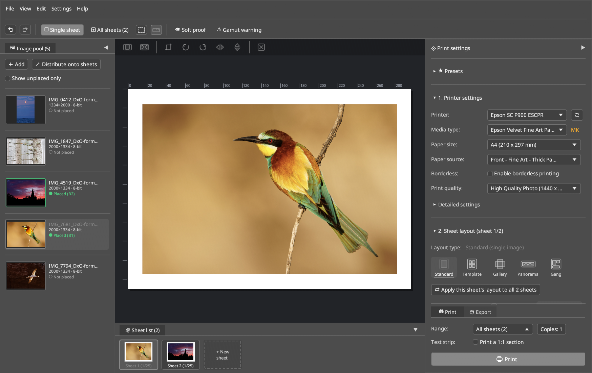

<p align="center"></p>

# LumaPrint — Fine-Art Print Layout & 16-Bit Color Studio

**LumaPrint** is a fine-art print layout, live softproofing, and 16-bit color management application for Linux, written in Rust. Inspired by **Epson Print Layout** and **TurboPrint Composer**, it combines a studio-style layout workflow with ICC color management (LittleCMS 2) and **CUPS / IPP** integration. 

> [!WARNING]
> **Beta.** Developed and tested on Fedora (KDE Plasma, Wayland) with an Epson SureColor SC-P900 and the companion driver [`epson-p900-escpr-cups`](https://github.com/colorcube/epson-p900-escpr-cups). Verified so far with real prints: ICC color management (relative colorimetric + BPC) and Advanced B&W Photo on Epson Photo Paper Glossy, A4. The data sent to the printer was compared with Epson Print Layout captures (see below). Other printers, drivers and layout modes are implemented but less tested.

LumaPrint is **printer-independent** and works out of the box with any printer installed in CUPS (such as the custom Epson SureColor SC-P900 `epson-p900-escpr-cups` driver, Gutenprint, vendor PPDs, or IPP Everywhere queues), while automatically preventing double color management between the application and the printer driver.



---

## Quickstart

### 1. Supported Systems & Prerequisites (Linux)

- **Distributions:** Developed and tested on Fedora 43/44 (KDE Plasma 6); works on Debian 13+, Ubuntu 24.04+, Arch Linux, openSUSE Tumbleweed, and other modern Linux distributions.
- **Display Server (`lumaprint` GUI):** **Wayland** (recommended: native wide-gamut `wp_color_manager_v1` support under KDE Plasma 6 / KWin `>= 6.2` and native Wayland file drag-and-drop) and **X11**. `lumaprint-cli` runs headless without a display server.
- **CUPS:** `>= 2.3` (`lp`, `lpstat`, `lpoptions`, `ipptool`).
- **Rust Toolchain:** `>= 1.85` (Rust 2024 Edition).

Install `pkg-config`, LittleCMS 2 (`liblcms2`), and standard Wayland/X11/OpenGL development headers:

```bash
# Debian / Ubuntu / Linux Mint
sudo apt install build-essential pkg-config liblcms2-dev libwayland-dev libxkbcommon-dev libgl1-mesa-dev cups-client

# Fedora / RHEL
sudo dnf install gcc pkgconf-pkg-config lcms2-devel wayland-devel libxkbcommon-devel mesa-libGL-devel cups-ipptool

# Arch Linux / Manjaro
sudo pacman -S base-devel pkgconf lcms2 wayland libxkbcommon mesa libcups
```

### 2. Launch or Install the Desktop Studio (`lumaprint`)

Install the `.deb` (Debian/Ubuntu) or `.rpm` (Fedora/openSUSE) package from [GitHub Releases](https://github.com/colorcube/lumaprint/releases) (includes `lumaprint`, `lumaprint-cli`, desktop entry, icons, and the offline English & German HTML manuals):

```bash
# Fedora / openSUSE (.rpm):
sudo dnf install ./lumaprint-*.x86_64.rpm

# Debian / Ubuntu (.deb):
sudo apt install ./lumaprint_*_amd64.deb
```

Or build and start directly from a source checkout:

```bash
cargo run --release -p lumaprint

# Or install into ~/.local/bin and ~/.local/share for the current user:
./bin/install-desktop              # builds --release and installs into ~/.local/{bin,share}
./bin/install-desktop --uninstall  # removes the installed files
```

### 3. Your First Fine-Art Print in 4 Steps

*(The UI defaults to English and automatically switches to German on German systems; switchable anytime under **Settings → Language**.)*

1. **Add Images to the Pool:** Click **`➕ Add`** (`➕ Hinzufügen`) in the **Image Pool** dock (or drag & drop image files/folders directly from your file manager into the window).
2. **Place Images on Sheets:** Drag an image from the Pool onto the dashed slot on **Sheet 1**, or click **`🪄 Distribute to Sheets`** (`🪄 Auf Bögen verteilen`) to automatically distribute all unplaced images across one or more print sheets.
3. **Select Printer, Paper & Color Mode:**
   - In the right **Print (`🖨 Print`)** dock, choose your **CUPS printer queue**, **Media Type** (including custom media imported from [`ep-media-installer` (`epmi`)](https://github.com/colorcube/ep-media-installer)), **Paper Size**, and **Paper Feed**.
   - Under **Color Management**, stay in **`Normal`** view for automatic, foolproof operation:
     - **`Color-Managed (ICC Paper Profile)`** (`Farbverbindlich (ICC-Papierprofil)`): LumaPrint transforms the 16-bit image using the paper's ICC profile (*Relative Colorimetric + Black Point Compensation*) and instructs the CUPS driver to disable internal color adjustment (`NoColorAdjustment`).
     - **`Printer Auto`** (`Drucker-Automatik`): Sends the image in *Adobe RGB (1998)* and lets the printer driver perform color conversion (automatically switches to ICC mode if you select third-party custom media or enable Softproof).
   - Switch to **`Advanced`** (`Erweitert`) if you need **Advanced B&W Photo (`ABW`)**, manual ICC profile selection, custom rendering intents, or raw **Calibration (`No Color Management`)** targets.
4. **Softproof, Print, or Export:**
   - Toggle **`👁 Softproof`** (with optional **Paper White simulation**, viewing light `D50` / `D65` / `3200K`, and **`⚠ Gamut Warning`**) in the top toolbar to preview how the print will look on your specific paper.
   - In the sticky footer at the bottom right, choose **`[ 🖨 Print ]`** to verify printer reachability and spool at native 720 DPI to CUPS, or switch to **`[ 💾 Export ]`** to export 16-bit TIFF/PNG sheets (`300` / `360` / `720` / `1440 dpi`).

### 4. Headless CLI Quickstart (`lumaprint-cli`)

Every feature of the layout and color engine is also accessible without a GUI via `lumaprint-cli`:

```bash
# Show detected CUPS printers, media database, and ICC profiles
cargo run -p lumaprint-cli -- info
cargo run -p lumaprint-cli -- printers

# Render a 16-bit ICC color-managed print sheet to a TIFF file (720 DPI)
cargo run --release -p lumaprint-cli -- render \
  --input photo.tif \
  --paper A4 \
  --media VelvetFineArt \
  --color icc \
  --intent relative \
  --dpi 720 \
  --output sheet_a4_720dpi.tif

# Send a print job directly to a CUPS printer queue
cargo run --release -p lumaprint-cli -- print \
  --printer Epson_SC_P900 \
  --input photo.tif \
  --paper A3+ \
  --media PremiumLuster \
  --color icc \
  --dpi 720

# Query live printer status and ink levels over IPP
cargo run -p lumaprint-cli -- status --host 192.168.178.50
```

---

## Companion Projects & Version Compatibility

While **LumaPrint** works with any CUPS printer (Gutenprint, TurboPrint, vendor PPDs, IPP Everywhere), it forms a complete Fine-Art printing suite on Linux together with two companion Rust projects for Epson SureColor printers:

| Project | Version | Compatible With | Role |
| :--- | :--- | :--- | :--- |
| **`LumaPrint` (this repository)** | `0.1.x` | Any CUPS queue<br>`epson-p900-escpr-cups >= 0.3.0`<br>`ep-media-installer >= 0.1.0` | Printer-independent 16-bit Fine-Art print layout, live softproofing, and Advanced B&W studio |
| **[`epson-p900-escpr-cups`](https://github.com/colorcube/epson-p900-escpr-cups)** | `0.3.x` | `LumaPrint >= 0.1.0`<br>`ep-media-installer >= 0.1.0`<br>Any CUPS client | Native Rust CUPS filter (`rastertop900escpr`), dynamic PPD generator, and privileged helper for Epson SureColor SC-P900 / SC-P700 |
| **[`ep-media-installer` (`epmi`)](https://github.com/colorcube/ep-media-installer)** | `0.1.x` | `epson-p900-escpr-cups >= 0.3.0`<br>`LumaPrint >= 0.1.0` | CLI & GUI (`epmi-gui`) for managing the printer's 30 NVRAM custom media slots via SNMP, `.emx` / cloud media, and system-wide ICC profiles |

---

## Key Features

### Multi-Page Image Pool & Sheet Workflow
- **Non-Destructive Image Pool:** Load individual 8-bit/16-bit TIFF, PNG, JPEG, or PPM files or entire directories into the Pool without cluttering your active sheet. Usage badges (`○ Unplaced`, `● Placed (S1)`, `● 2× (S1, S3)`) track where each image is placed.
- **Multi-Sheet Navigator & Light-Table (`⊞ All Sheets`):** Work on a single sheet in detail (`▢ Single Sheet`) or switch to the multi-sheet light-table overview (`Ctrl+2`) to drag & drop images across slots and sheets.
- **Freely Configurable Docks:** Drag & drop the **Image Pool** and **Sheet List** docks by their tab headers to dock them on the left, right (tabbed), bottom inside the canvas, or full-width across the bottom; collapse any edge with `F8` / `F9` / `F10`.

### 5 Studio Layout Modes & 2-Stage Template Studio
- **Standard (`Single Image`):** Size by **Margins** or exact **Image Size** with proportional aspect-ratio locking, one-click centering, custom frame borders (`mm` + custom color palette), and borderless printing (*Auto-Expand Min/Mid/Max* vs. *Retain Size*).
- **Collection Sheet (`Free Composer`):** Place up to 25 images of arbitrary physical sizes (`9×13`, `10×15`, `13×18`, or custom `mm`) on a sheet with automatic 2D bin-packing and multi-sheet overflow balancing.
- **Template & 2-Stage Template Studio:**
  - **Stage 1 (Grid & Bento Wizard):** Configure an $N \times M$ grid with exact outer margins and gutters, then select adjacent cells on the canvas to merge (`🔗 Merge`) or split (`✂ Split`) into custom Bento layouts.
  - **Stage 2 (Free Slot Editor):** Unlock free positioning and 8-handle resizing with magnetic alignment snapping and exact millimeter input (`X`, `Y`, `Width`, `Height`).
  - Supports **corner crop marks** and **automatic slot captions** (`#01`, filename, dimensions).
- **Gallery Wrap:** Calculates required paper dimensions, frame depth, back-wrap margin, corner cut marks, and 6 edge-wrap modes (*None, Solid Color, Mirror, Mirror with Soft Shadow/Blur, Extend Image, Extend Image with Soft Shadow/Blur*).
- **Panorama:** Roll-paper and banner printing with automatic length calculation.

### 16-Bit Color Management (`liblcms2`), Wayland Wide-Gamut & Advanced B&W (`ABW`)
- **16-Bit Pipeline:** Images are decoded, scaled, toned and color-converted in 16 bit with **LittleCMS 2 (`liblcms2`)**, supporting ICC v2 and v4 profiles (including `mAB ` / `mBA ` LUT-based profiles of third-party fine-art papers). Embedded source profiles are converted via their real colorants and tone curves. Only the final spool image is rounded to 8 bit, because CUPS raster and the printer protocol carry 8 bits per channel.
- **Compared With Epson Print Layout:** Print jobs captured from LumaPrint and from Epson Print Layout (Windows) on the same chart: identical printer command headers; ICC mode deviates by 0.16 of 255 levels on average (max. 3), Advanced B&W by about 0.5 (EPL uses the Windows color engine for its sRGB conversion). Side-by-side prints show no visible difference.
- **Native Wayland Color Management (`wp_color_manager_v1`):** Automatically detects wide-gamut displays (`Adobe RGB`, `Display P3`, `sRGB`) under KDE Plasma / KWin Wayland and tags the window surface so your monitor displays its full native color gamut without sRGB clipping.
- **Live Softproof & Gamut Check:** Real-time proofing transform (`cmsCreateProofingTransformTHR`) with optional **Paper White simulation** (tinting both the image and the surrounding sheet canvas to match warm cotton/baryta papers), viewing light temperature (`D50 5000K`, `D65 6500K`, `Gallery Warm 3200K`), and out-of-gamut overlay.
- **Advanced B&W Photo (`ABW`):** Interactive 2D tone wheel, presets (*Neutral, Cool, Warm, Sepia*), tonal curve controls, shadow/highlight toning, max optical density, and *Highlight Point Shift* (places trace ink on pure white to eliminate gloss differential). With `epson-p900-escpr-cups` the toning runs in the printer firmware like in Epson Print Layout (`EpsonColorMode=AdvancedBW` + `EpsonAbw*` options); other drivers get LumaPrint's software toning.

### Everyday Comfort
- **Settings are kept across restarts** (`~/.config/lumaprint/settings.json`): printer, paper, quality, color settings, theme, presets, custom media and templates.
- **Original size:** The resolution stored in TIFF, JPEG and PNG files is read, so an image can be placed at its original print size with one click.
- **Delete key** removes the selected image from its slot or from the pool; undo restores it.

### Generic System Printer (`CUPS`) & `IPP` Integration
- **Automatic Queue & PPD Discovery (`lumaprint-cups`):** Reads installed queues (`lpstat`), supported paper sizes, media types, input slots, resolutions, and `*cupsICCProfile` rules directly from `/etc/cups/ppd/<queue>.ppd` and `lpoptions`.
- **Automatic Double-Color-Management Protection:** Detects the driver family (`epson-p900-escpr-cups` / Epson, `Gutenprint`, `TurboPrint`, generic CUPS) and passes the exact flags (`EpsonColorMode=NoColorAdjustment`, `StpColorCorrection=None`, `zedoColorCorrection=0`, `cm-calibration=true`) when LumaPrint manages color.
- **Custom Media Integration:** Reads the system paper database that [`ep-media-installer`](https://github.com/colorcube/ep-media-installer) installs (*“Install for this computer”*: `/etc/epson-p900-escpr-cups/custom_media.json`, ICC profiles in `/usr/local/share/color/icc/epson-p900-custom/`; development override `$EPSON_P900_CUSTOM_MEDIA_JSON`) and passes `UserMediaID`, `PrintDuty`, `DryingTime`, `BottomEdgePriority`, and `RubbingReduction` to CUPS.
- **Pre-Flight Reachability & Post-Spool Verification:** Verifies that the target CUPS queue is enabled and network printers (`ipp://`, `ipps://`, `socket://`, `http://`, `lpd://`) are reachable via TCP before rendering, and cancels stuck jobs immediately if the CUPS backend reports the printer offline.
- **Generic IPP Status (`lumaprint-ipp`):** Queries live printer state and ink/toner marker levels (`marker-names`, `marker-levels`, `marker-colors`) over IPP (`RFC 8011`).

---

## Architecture (`L0–L6` Layered Workspace)

LumaPrint enforces a strict, dependency-acyclic layered architecture where the core engine is 100% independent of the GUI:

| Layer | Crate | Responsibility |
| :--- | :--- | :--- |
| **L0** | [`crates/i18n`](crates/i18n) | Bilingual UI localization (`English` / `Deutsch`) |
| **L0** | [`crates/geom`](crates/geom) | Physical units (`mm`, `inch`, `pt`, `px` at DPI), paper size catalog, aspect-ratio fitting, and layout geometry |
| **L1** | [`crates/color`](crates/color) | 16-bit buffers (`ImageBuffer16`), 16→8-bit conversion, and Advanced B&W (`ABW`) synthesis |
| **L1.5** | [`crates/cms`](crates/cms) | ICC v2/v4 profile parsing, LittleCMS 2 (`liblcms2`) 16-bit transforms, softproofing, paper-white adaptation, and gamut checking |
| **L2** | [`crates/codecs`](crates/codecs) | Lossless 8/16-bit TIFF, PNG, JPEG, and PPM decoding/encoding with embedded ICC profile extraction and DPI metadata |
| **L3** | [`crates/doc`](crates/doc) | Serializable print job document model (`PrintJobDocument`), media database, color settings, export settings, and user backup |
| **L3.5** | [`crates/layout`](crates/layout) | Sheet layout solver for Standard, Collection Sheet (bin-packing), Template (Bento/Free), Gallery Wrap, and Panorama |
| **L4** | [`crates/render`](crates/render) | 16-bit high-DPI print & export compositor and wide-gamut screen preview renderer |
| **L4** | [`crates/cups`](crates/cups) | CUPS queue discovery, PPD parser, custom media loader, reachability verifier, and `lp` spooler |
| **L4** | [`crates/ipp`](crates/ipp) | Generic IPP (`RFC 8011`) client for live printer status and ink/toner levels |
| **L5** | [`crates/engine`](crates/engine) | Stateful `Session`, undo/redo history, command execution (`EngineCommand`), and media constraint solver |
| **L6** | [`crates/ui-egui`](crates/ui-egui) | Hardware-accelerated `egui`/`eframe` desktop studio with Wayland color management (`wp_color_manager_v1`) |
| **App** | [`apps/lumaprint`](apps/lumaprint) | Desktop GUI binary |
| **App** | [`apps/lumaprint-cli`](apps/lumaprint-cli) | Headless CLI binary for batch rendering, scripting, and CI testing |

---

## Development & Verification

```bash
# Run the full test suite across all workspace crates
cargo test --workspace

# Run strict Clippy lints (zero warnings policy)
cargo clippy --workspace --all-targets -- -D warnings
```

## Documentation & Troubleshooting

User guides, color management deep-dives, and architecture notes (prepared for **Zensical** via [`zensical.toml`](zensical.toml) and [`zensical.de.toml`](zensical.de.toml)) are located in [`docs/`](docs/README.md):

- **English Manual & Technical Reference ([`docs/README.md`](docs/README.md)):**
  - [User Guide Overview (`docs/manual/en/`)](docs/manual/en/README.md)
  - [1. Quickstart & Typical Workflow](docs/manual/en/1-quickstart-and-workflow.md)
  - [2. Main Window, Image Pool & Docks](docs/manual/en/2-main-window-and-docks.md)
  - [3. Layout Modes & Template Studio](docs/manual/en/3-layout-modes-and-templates.md)
  - [4. Printer, Media & Paper Feed](docs/manual/en/4-printer-media-and-cups.md)
  - [5. Color Management, Soft Proof & Advanced B&W](docs/manual/en/5-color-management-and-abw.md)
  - [6. Fundamentals: Color Spaces & ICC Profiles Explained](docs/manual/en/6-color-spaces-explained.md)
  - [7. Pro Features, 16-Bit Export & IPP Ink Levels](docs/manual/en/7-pro-features-and-ipp.md)
  - [Layered Architecture (`L0–L6`)](docs/architecture.md)
- **Deutsches Benutzerhandbuch ([`docs/README.de.md`](docs/README.de.md)):**
  - [Kapitelübersicht (`docs/manual/de/`)](docs/manual/de/README.md)
  - [1. Schnellstart & Typischer Workflow](docs/manual/de/1-schnellstart-und-workflow.md)
  - [2. Hauptfenster, Bilder-Pool & Docks](docs/manual/de/2-hauptfenster-und-bedienung.md)
  - [3. Layout-Modi & Vorlagen-Studio](docs/manual/de/3-layout-modi-und-vorlagen.md)
  - [4. Drucker, Medien & Papierzufuhr](docs/manual/de/4-drucker-medien-und-zufuhr.md)
  - [5. Farbmanagement, Softproof & Advanced B&W](docs/manual/de/5-farbmanagement-softproof-und-abw.md)
  - [6. Grundlagen: Farbräume & ICC-Profile erklärt](docs/manual/de/6-farbraeume-und-profile-erklaert.md)
  - [7. Profi-Funktionen, 16-Bit-Export & IPP-Tintenstand](docs/manual/de/7-pro-funktionen-und-ipp.md)

### Quick Troubleshooting
- **Inspecting CUPS filter logs:** Enable verbose logging with `sudo cupsctl --debug-logging` and watch `sudo journalctl -u cups -f` (or `/var/log/cups/error_log`).
- **Custom media from `ep-media-installer` do not appear:** Click **“Install for this computer”** in `epmi-gui` (or run `epmi install-system`) so `/etc/epson-p900-escpr-cups/custom_media.json` and the queue PPDs are updated, then click **`🔄`** next to the printer selector in LumaPrint.
- **SELinux (Fedora / RHEL):** Check for denials with `sudo ausearch -m avc -ts recent` and restore contexts via `sudo restorecon -RFv /etc/epson-p900-escpr-cups /usr/local/share/color/icc/epson-p900-custom`.

## Third-Party Code

`vendor/winit` is a patched copy of [winit](https://github.com/rust-windowing/winit) 0.30.13 (Apache-2.0, see `vendor/winit/LICENSE`), used via `[patch.crates-io]`. The changes add native Wayland file drag-and-drop and reject unsupported drag-and-drop types; see the git history of `vendor/winit`.

## Trademarks

Epson, SureColor and Epson Print Layout are trademarks of Seiko Epson Corporation; TurboPrint is a trademark of ZEDOnet. LumaPrint is an independent project and is not affiliated with or endorsed by these companies. Their names are used only to describe compatibility and the workflow LumaPrint is modeled after.

## About the development

LumaPrint was developed with extensive help from AI. The code, the tests and the documentation were written by Google's Gemini and Anthropic's Claude under my direction. Requirements, design decisions, review and all tests with real hardware are my own.

## License

LumaPrint is free software: you can redistribute it and/or modify it under the terms of the **GNU General Public License as published by the Free Software Foundation, either version 3 of the License, or (at your option) any later version** (`GPL-3.0-or-later`). See [`LICENSE`](LICENSE).

The patched copy of winit in `vendor/winit` remains under its original Apache-2.0 license.
