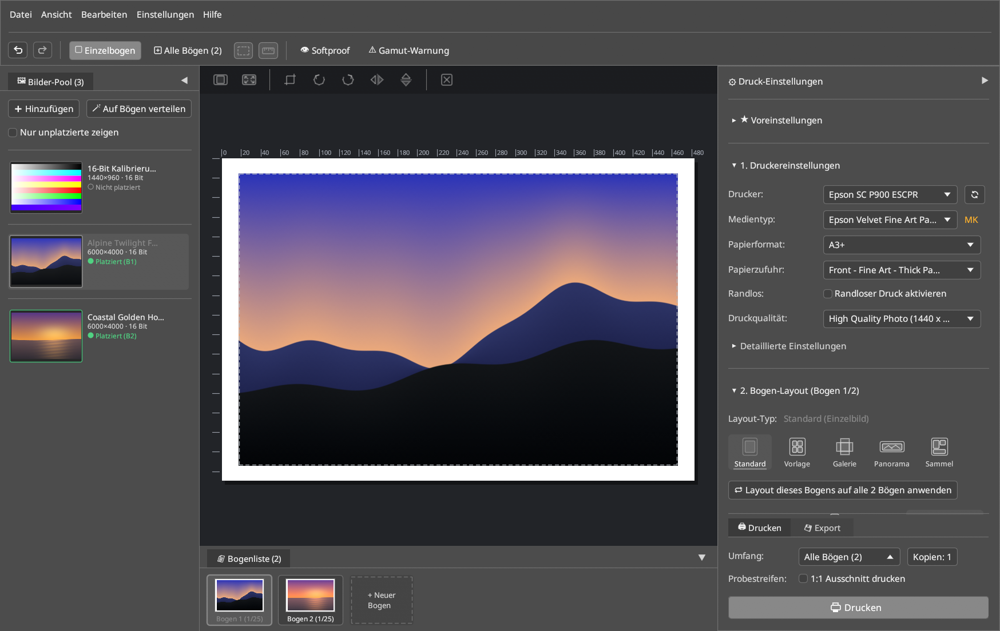

# 1. Schnellstart & Typischer Arbeitsablauf

Dieses Kapitel zeigt die Installation von **LumaPrint**, den Start der Desktop-Anwendung und den direkten Weg zum ersten farbverbindlichen Fine-Art-Druck in vier Schritten.

---

## 1. Installation & Start

### Aus dem Quellcode bauen und installieren

```bash
cargo build --release --workspace
sudo install -m 0755 target/release/lumaprint target/release/lumaprint-cli /usr/local/bin/
./bin/install-desktop
```

Der Aufruf `./bin/install-desktop` installiert den Desktop-Starter (`de.colorcube.lumaprint.desktop`), die AppStream-Metadaten sowie die Anwendungs-Icons in `~/.local/share`, sodass **LumaPrint** direkt im Anwendungsmenü (KDE Plasma, GNOME, Xfce) erscheint.

### LumaPrint starten

Starte **LumaPrint** über das Anwendungsmenü oder im Terminal:

```bash
# Mit leerer Sitzung starten:
lumaprint

# Oder eine bzw. mehrere Bilddateien direkt beim Start übergeben:
lumaprint ~/Fotos/FineArt_01.tif ~/Fotos/FineArt_02.tif
```

> [!TIP]
> Du kannst LumaPrint in **Darktable**, **RawTherapee**, **DigiKam** oder **Geeqie** als externes Druck-Werkzeug hinterlegen, indem du den Dateipfad des exportierten 16-Bit-TIFFs als Argument an `lumaprint` übergibst.

---

## 2. Der erste Fine-Art-Druck in 4 Schritten



### Schritt 1: Bilder in den Bilder-Pool laden (Linkes Dock)

1. Klicke im **🖼 Bilder-Pool** links auf **+ Hinzufügen** (`Strg+O`) oder ziehe `.tif`-, `.png`-, `.jpg`- oder `.webp`-Dateien per Drag & Drop aus dem Dateimanager in das Fenster.
2. Um ein Bild auf dem aktuellen Bogen zu platzieren, **doppelklicke** es im Bilder-Pool, **ziehe** es auf einen Slot auf dem Bogen oder klicke auf **🪄 Auf Bögen verteilen**, um alle unplatzierten Bilder automatisch auf Druckbögen zu verteilen.

### Schritt 2: Drucker, Medientyp & Papierformat wählen (Rechtes Dock → `1. Druckereinstellungen`)

1. Wähle unter **Drucker** deine CUPS-Warteschlange (z. B. `Epson_SC_P900`).
2. Wähle unter **Medientyp** das eingelegte Papier (z. B. `Velvet Fine Art Paper` oder ein über [`epmi`](https://github.com/colorcube/ep-media-installer) installiertes Fremdpapier).
   - LumaPrint zeigt automatisch die passende Schwarztinte (**`PK`** Photo Black vs. **`MK`** Matte Black) und stellt die empfohlene **Papierzufuhr** ein (z. B. `Hinterer Einzug (Blatt)` oder `Vorderer Einzug – Fine Art`).
3. Wähle das **Papierformat** (z. B. `A4`, `A3`, `A3+`, `A2`) und die **Druckqualität** (z. B. `Hohe Qualität / Foto (1440 x 1440 dpi)` oder `Max. Qualität (2880 x 1440 dpi)`).

### Schritt 3: Layout anpassen (`2. Bogen-Layout`)

1. Wähle den **Layout-Typ**:
   - **Standard:** Einzelbild auf dem Bogen. Ziehe die Eckgriffe direkt auf dem Bogen oder gib exakte Ränder bzw. Bildmaße in Millimetern ein.
   - **Vorlage:** Multi-Bild-Kontaktbogen oder Bento-Layout (bis zu 25 Slots).
   - **Galerie:** Leinwand-Keilrahmen mit gespiegelten oder schattierten Umschlagkanten.
   - **Panorama:** Rollenpapier- und Bannerdruck.
   - **Sammel:** Automatisches, platzsparendes Verschachteln (*Auto-Nesting*) mehrerer Wunschformate.
2. Nutze die rahmenlose Icon-Leiste direkt über dem Druckbogen, um zwischen **Einpassen** und **Ausfüllen** zu wechseln, den **Bildbeschnitt** (`✂`) zu öffnen oder das Bild zu drehen/spiegeln.

### Schritt 4: Farbmanagement, Softproof & Druck (`3. Farbeinstellungen` & Fußbereich)

1. Wähle unter **3. Farbeinstellungen** den **Farbmodus**:
   - **Farbmanagement (ICC-Papierprofil):** LumaPrint wendet das `.icc`-Profil des Papiers an (standardmäßig Relativ farbmetrisch + Tiefenkompensation/BPC) und schaltet die interne Farbkorrektur des Druckertreibers automatisch ab (`NoColorAdjustment`).
   - **Drucker-Automatik:** Übergibt das Bild im weiten `Adobe RGB (1998)`-Farbraum (`LUT 0x06`, wie *Epson Print Layout*) an den Druckertreiber.
   - **Schwarzweiß (Advanced B&W):** Aktiviert den neutralen oder getonten Schwarzweiß-Modus (Ansicht **Erweitert**).
2. Optional: Aktiviere oben in der Werkzeugleiste **👁 Softproof** (`Strg+Umschalt+S`) und **Papierweiß**, um den Weißpunkt und die Schwarzdichte des Papiers unter `D50 (5000K)`-Normlicht live am Monitor zu prüfen.
3. Wähle im festen Fußbereich des rechten Docks den **Umfang** (`Alle Bögen` oder `Aktueller Bogen`), aktiviere bei Bedarf **Probestreifen (1:1 Ausschnitt drucken)** für einen papiersparenden Teststreifen und klicke auf **🖨 Drucken** (oder wechsle auf den Tab **💾 Export**, um den Bogen als 16-Bit-TIFF/PNG zu speichern).

---

## 3. Headless CLI-Schnellstart (`lumaprint-cli`)

Für Batch-Workflows, Automatisierung oder den Druck von Kalibrierungs-Testcharts ohne GUI steht `lumaprint-cli` bereit:

```bash
# Gefundene CUPS-Drucker und ICC-Profile auflisten:
lumaprint-cli printers
lumaprint-cli icc-list

# Einen 16-Bit-Druckbogen mit 720 DPI als TIFF-Datei berechnen:
lumaprint-cli render \
  --image ~/Fotos/AlpineTwilight.tif \
  --paper A3+ \
  --media VelvetFineArt \
  --dpi 720 \
  --output /tmp/sheet_a3plus.tif
```
