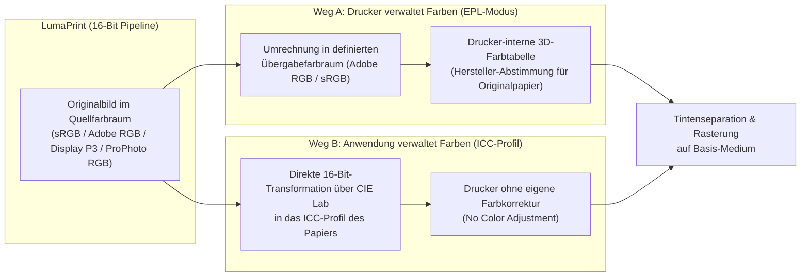

# 6. Grundlagen: Farbräume & ICC-Profile erklärt

Beim Fine-Art- und Fotodruck treffen zwei völlig unterschiedliche Farbwelten aufeinander: Ihr digitales Foto arbeitet mit **additiven Lichtfarben** (Rot, Grün, Blau auf einem selbstleuchtenden Monitor), während der Drucker **subtraktive Pigmenttinten** (beim Epson SureColor SC-P900 zehn verschiedene Tintenkanäle) auf Papier aufträgt, das Umgebungslicht reflektiert.

Dieses Kapitel erklärt Schritt für Schritt, wie Farbräume und ICC-Profile diese Übersetzung leisten, welche Rolle die Einstellungen im Druckertreiber spielen und wann welcher Farbmodus die richtige Wahl ist.

> [!NOTE]
> **Hinweis zur Übertragbarkeit auf andere Drucker:**
> Wir veranschaulichen das Zusammenspiel in diesem Kapitel am konkreten Beispiel der **Epson SureColor Fotodrucker (SC-P900 / SC-P700)**, da hier alle Modi besonders klar erkennbar sind. Die zugrunde liegenden Prinzipien – die Trennung zwischen druckerinterner Farbverwaltung (`sRGB` / `Adobe RGB`) und anwendungsseitigem ICC-Farbmanagement – gelten jedoch **identisch oder nahezu identisch auch für Fotodrucker anderer Hersteller** (wie Canon imagePROGRAF / PIXMA PRO, HP DesignJet) sowie für moderne treiberlose Netzwerkdrucker (*IPP Everywhere / AirPrint*).

---

## 1. Das Grundprinzip: Warum RGB nicht gleich RGB ist

Eine Bilddatei speichert für jedes Pixel drei Farbwerte: **Rot, Grün und Blau (RGB)** – bei 8-Bit-Bildern als Zahlen von `0` bis `255`, bei 16-Bit-Bildern von `0` bis `65535`.

Ohne Zusatzinformation sind diese Zahlen jedoch mehrdeutig: Ein Wert wie `RGB(0, 255, 0)` bedeutet lediglich *„das kräftigste Grün, das in diesem System möglich ist“*, sagt aber noch nicht, **welcher reale Farbton** damit gemeint ist. Erst ein zugeordneter **Quellfarbraum** (eingebettet in der Bilddatei) verknüpft die RGB-Zahlen mit einem absoluten, geräteunabhängigen Referenzsystem (**CIE Lab / CIE XYZ**), das auf dem menschlichen Sehvermögen basiert.

### Die wichtigsten Quellfarbräume in der Fotografie

| Farbraum | Charakteristik & Einsatzgebiet | Bedeutung für den Fotodruck |
| :--- | :--- | :--- |
| **sRGB** | Kleinster gemeinsamer Nenner für Webbrowser, Smartphones und Standard-Büromonitore. | Schneidet hochgesättigte Türkis-, Smaragdgrün-, Gelb- und tiefe Blautöne ab, die moderne Kameras aufnehmen und hochwertige Fotodrucker problemlos drucken können. |
| **Adobe RGB (1998)** | Deutlich erweiterter Farbumfang, insbesondere in den Grün-, Cyan- und Blautönen. | Sehr guter Allround-Farbraum für den Fotodruck; deckt den Großteil der druckbaren Farben ab. |
| **Display P3** | Moderner Wide-Gamut-Standard aktueller Monitore und Mobilgeräte (etwa 25 % größer als sRGB, stark in Rot/Orange/Grün). | Gute Abdeckung warmer und leuchtender Farbtöne, im Cyan-Bereich jedoch etwas enger als Adobe RGB. |
| **ProPhoto RGB (ROMM)** | Extrem großer Arbeitsfarbraum (Standard in RAW-Entwicklern wie Lightroom oder Darktable), der nahezu alle fotografisch erfassbaren Farben einschließt. | Sollte als **16-Bit-Datei** (z. B. 16-Bit TIFF) übergeben werden, um Tonwertabrisse zu vermeiden. Erlaubt es dem Drucker, selbst feinste Spitzenfarben am Rand seines physikalischen Leistungsvermögens voll auszuschöpfen. |

### Wie LumaPrint mit Quellfarbräumen umgeht

Viele einfache Druckprogramme wandeln importierte Bilder bereits beim Öffnen pauschal in `sRGB` um – wodurch alle erweiterten Farben aus `Adobe RGB` oder `ProPhoto RGB` unwiederbringlich verloren gehen.

**LumaPrint arbeitet anders:** Jedes importierte Bild behält im Speicher seinen **originalen 16-Bit-Quellfarbraum** (`sRGB`, `Adobe RGB`, `Display P3` oder `ProPhoto RGB`) bei. Erst ganz am Ende der Pipeline – unmittelbar für die Monitor-Vorschau oder für den Druckauftrag – werden die Farben in 16-Bit-Präzision in den jeweiligen Zielfarbraum überführt.

---

## 2. Was der Drucker tatsächlich empfängt

Obwohl ein Fotodrucker wie der Epson SC-P900 mit **zehn einzelnen Tintenkanälen** druckt (*Photo Black, Matte Black, Gray, Light Gray, Cyan, Light Cyan, Vivid Magenta, Vivid Light Magenta, Yellow, Violet*), erwartet er vom Computer bei regulären Druckaufträgen keine einzelnen Tintentröpfchen-Steuerbefehle pro Düse.

Stattdessen empfängt der Drucker weiterhin **24-Bit-RGB-Pixeldaten** (bei 720 DPI). Die feine Aufteilung dieser RGB-Werte in die zehn Tintenkanäle (z. B. wann abgedunkelt, wann Hellcyan statt Vollcyan oder wann Violett zugemischt wird) sowie die Rasterung übernimmt die **Hardware/Firmware im Drucker selbst** (bei anderen Herstellern übernimmt diesen Schritt analog die Firmware oder der proprietäre Treiberkern).

Die zentrale Frage beim Drucken lautet daher:

> **Wer übernimmt die farbmetrische Übersetzung vom Foto zum Papier – der Drucker selbst (Weg A) oder die Anwendung mithilfe eines ICC-Papierprofils (Weg B)?**

---

## 3. Weg A: Der Drucker verwaltet die Farben („Epson Print Layout“-Modus)

### Warum existiert dieser Modus?

Nicht jedes Programm auf einem Computer beherrscht ICC-Farbmanagement, kennt Papierprofile oder bietet Einstellungen für *Rendering Intents* und *Tiefenkompensierung*. Damit Anwender dennoch aus beliebigen Programmen (oder ohne manuelle Profilverwaltung) hochwertige Ausdrucke erhalten, besitzen Fotodrucker **fest eingebaute Umrechnungstabellen (Hardware-LUTs)** für die originalen Papiersorten des Herstellers.

Im Prinzip sagt der Drucker in diesem Modus: *„Schicke mir die Bilddaten einfach in einem bekannten Standard-Farbraum (`sRGB` oder `Adobe RGB`) und teile mir die eingelegte Original-Papiersorte mit – um die restliche Farbabstimmung kümmere ich mich selbst.“*

### Die Rolle von `sRGB` vs. `Adobe RGB` in diesem Modus

Da in diesem Modus kein individuelles Papierprofil auf dem Computer zwischengeschaltet ist, müssen sich Anwendung und Drucker darauf einigen, in welchem Farbraum die gesendeten RGB-Zahlen codiert sind:

1. **Übergabe als `sRGB` (*Epson Standard sRGB*):**
   LumaPrint rechnet das Bild vor dem Senden in `sRGB` um und signalisiert dem Drucker, seine interne `sRGB`-Tabelle zu nutzen. Kräftige Farben außerhalb des kleinen `sRGB`-Farbraums werden dabei bereits vor dem Senden beschnitten.
2. **Übergabe als `Adobe RGB` (*Epson Print Layout Automatik*):**
   LumaPrint übergibt die Bilddaten im deutlich größeren **`Adobe RGB (1998)`**-Farbraum und weist den Drucker an, seine interne `Adobe RGB`-Hardwaretabelle zu verwenden. Dadurch bleiben gesättigte Blau-, Türkis- und Grüntöne erhalten und werden vom Drucker in den vollen Tintenfarbraum übersetzt.

### Charakteristik und Grenzen dieses Modus

- **Gefällige Werksabstimmung („Foto-Look“):** Die druckerinterne Tabelle arbeitet nicht streng messwertneutral, sondern wendet eine herstellereigene Optimierung an (etwas frischere Hauttöne, kräftigerer Kontrast, leuchtendes Himmelsblau).
- **Nur für Originalpapiere des Herstellers:** Die Firmware des Druckers kennt ausschließlich die ab Werk eingespeicherten Original-Papiersorten. Die spezifische Oberflächenfärbung und Tintenaufnahme von Papieren anderer Hersteller (z. B. Hahnemühle, Photolux, Canson, Ilford) sind dem Drucker unbekannt.
- **Kein exakter Softproof möglich:** Da die proprietäre Umrechnung erst im geschlossenen Chip des Druckers stattfindet, lässt sich das Ergebnis vorab am Monitor nicht 1:1 per Softproof simulieren.

---

## 4. Weg B: Die Anwendung verwaltet die Farben (ICC-Papierprofile & Fremdpapiere)

Für farbverbindliches Arbeiten, für den **Softproof am Monitor** sowie für **sämtliche Fine-Art-Papiere von Drittanbietern** ist das **ICC-Farbmanagement in der Anwendung** der Königsweg.

### Wie funktioniert ein ICC-Papierprofil technisch?

Ein verbreitetes Missverständnis lautet, ein ICC-Profil für ein Fremdpapier (etwa *Hahnemühle Photo Rag* oder *Photolux Studio*) würde den Drucker komplett neu von Grund auf ansteuern. Tatsächlich arbeitet das System **zweistufig**:

1. **Stufe 1 – Das Basis-Medium als physikalisches Fundament im Drucker:**
   Jedes ICC-Profil baut auf einem konkreten **Standard-Basispapier** des Druckers auf (für matte Baumwollpapiere meist *Velvet Fine Art Paper*, für Baryt-/Luster-Papiere oft *Premium Semigloss* oder *Premium Luster*). Welches Basis-Medium einzustellen ist, gibt der Papierhersteller im Datenblatt des Profils vor.
   Dieses Basis-Medium regelt im Drucker alle physikalischen Grundeigenschaften:
   - Walzenabstand (*Platen Gap*) und Vorschubgeschwindigkeit,
   - die Wahl zwischen *Photo Black (PK)* und *Matte Black (MK)*,
   - die maximale Grundtintenmenge (damit das Papier nicht wellt oder übersättigt),
   - sowie die Grundlinearisierung der zehn Tintenkanäle.
2. **Stufe 2 – Die Profilierung ohne Drucker-Farbkorrektur (`No Color Adjustment`):**
   Um ein ICC-Profil für ein neues Papier zu erstellen, wird im Treiber das passende Basis-Medium gewählt und jegliche druckerinterne Farbkorrektur abgeschaltet (**`No Color Adjustment`**). In diesem Rohzustand wird ein Testchart mit Hunderten bekannten `(R, G, B)`-Steuerwerten gedruckt.
   Dieser erste unkorrigierte Ausdruck weist naturgemäß noch Farbstiche oder Helligkeitsabweichungen auf. Anschließend misst ein Spektralphotometer jedes gedruckte Farbfeld im absoluten **`CIE Lab`-Farbraum** aus.
3. **Stufe 3 – Das ICC-Profil als präzise Korrekturtabelle:**
   Aus dem Vergleich zwischen den gesendeten `(R, G, B)`-Steuerwerten und den auf dem Papier tatsächlich gemessenen `Lab`-Farben entsteht das `.icc`-Profil. Es enthält zwei Richtungen:
   - **Für den Druck (`Lab → Drucker-RGB`):** Das Profil weiß exakt, welche vorverzerrten `(R', G', B')`-Steuerwerte an den Drucker im Modus `No Color Adjustment` gesendet werden müssen, damit auf dem Papier am Ende genau der gewünschte `Lab`-Farbton aus Ihrem Foto entsteht.
   - **Für den Softproof am Monitor (`Drucker-RGB / Lab → Monitor`):** Da bei der Messung auch das reale Papierweiß, das tiefste erreichbare Schwarz ($D_{\max}$) und die äußersten darstellbaren Farben erfasst wurden, kennt das ICC-Profil den realen Farbumfang dieser Papier-Tinten-Kombination und kann ihn am Monitor vorab zuverlässig simulieren.

### Kein Umweg über sRGB oder Adobe RGB!

Ein entscheidender Vorteil des ICC-Modus in LumaPrint:
Wenn Sie mit einem ICC-Papierprofil drucken, wird Ihr Bild **weder in sRGB noch in Adobe RGB zwischengerechnet**.

Liegt Ihr Foto beispielsweise im großen **`ProPhoto RGB`**- oder **`Adobe RGB`**-Farbraum vor, übersetzt die Farbmanagement-Engine (`LittleCMS 2`) in LumaPrint jedes Pixel in 16-Bit **direkt aus dem Quellfarbraum des Bildes über `CIE Lab` in die Steuerwerte des Papier-ICC-Profils**. Jede Farbnuance Ihres Fotos, die die Tinten auf diesem Papier physikalisch darstellen können, gelangt ohne künstliches Nadelöhr aufs Papier.

> [!IMPORTANT]
> **Grundregel beim Drucken mit ICC-Profilen: Niemand darf dazwischenfunken!**
> Wenn man die vom ICC-Profil berechneten Druckdaten ungefiltert auf einem Monitor betrachten würde, sähen sie oft farbstichig oder im Kontrast verschoben aus – denn sie enthalten bereits die exakte Gegenkorrektur für das jeweilige Papier.
> Damit auf dem Papier die Farben präzise stimmen, muss die eigene Farbkorrektur des Druckers zwingend deaktiviert sein (**`No Color Adjustment`**) und dasselbe Basis-Medium aktiv sein, auf dem das Profil eingemessen wurde. In **LumaPrint** geschieht diese Abschaltung der Treiber-Farbkorrektur im Modus *ICC-Profil verwenden* vollautomatisch.

---

## 5. Was speichert der „EP Media Installer (epmi)“ im Drucker?

Mit Werkzeugen wie dem *EP Media Installer (epmi)* lassen sich Konfigurationsdateien (`.emy` / `.emx`) für Papiere von Drittanbietern herunterladen und im Drucker registrieren. Auch hier ist die Aufgabenverteilung klar getrennt:

1. **Was im Drucker selbst gespeichert wird:**
   Der Drucker speichert in seinen Benutzer-Speicherplätzen (`Slot 1..10`) **ausschließlich die mechanischen und physikalischen Papierparameter**: Papiername für das Display, Walzenabstand, Papierdicke in Millimetern, Vorschubkorrektur, Trocknungszeit und die Zuordnung zum internen Basis-Medium. **Der Drucker selbst speichert und verarbeitet keine `.icc`-Farbprofile.**
2. **Was auf dem Computer gespeichert wird:**
   Das zugehörige `.icc`-Profil wird als Datei auf der Festplatte des Computers abgelegt. **LumaPrint** lädt dieses `.icc`-Profil für die 16-Bit-Farbumrechnung und den Softproof am Monitor und übergibt dem Drucker parallel die passenden mechanischen Custom-Media-Parameter.

---

## 6. Entscheidungshilfe für die Praxis: Welcher Modus wofür?

| Einstellung in LumaPrint | Wann verwenden? | Was passiert im Hintergrund? |
| :--- | :--- | :--- |
| **ICC-Profil verwenden** *(Empfohlener Standard für Fine-Art & Softproof)* | • **Zwingend** bei allen Papieren von Drittanbietern (Hahnemühle, Photolux, Canson, Ilford etc.) • Bei Originalpapieren, wenn höchste Farbverbindlichkeit und 1:1-Übereinstimmung mit dem **Softproof** am Monitor gewünscht sind | LumaPrint rechnet direkt vom Bildfarbraum (`ProPhoto RGB` / `Adobe RGB` / `sRGB`) in das `.icc`-Profil des Papiers um und schaltet die druckerinterne Farbkorrektur automatisch aus (`No Color Adjustment`). |
| **Drucker verwaltet Farben** *(Epson Print Layout Modus – `Adobe RGB`)* | • Schneller Alltags- und Porträt-Fotodruck auf **originalen Hersteller-Papieren** (z. B. *Epson Glossy, Premium Glossy, Luster, Baryta*), wenn die lebendige Werksabstimmung des Druckers gewünscht ist | LumaPrint übergibt das Bild verlustfrei im großen `Adobe RGB`-Farbraum an den Drucker; die Drucker-Firmware übernimmt die Farbabstimmung (*Epson Standard*). |
| **Advanced B&W Photo (ABW)** | • Für neutrale oder fein getonte Schwarzweiß-Fine-Art-Drucke | LumaPrint wandelt das Bild in 16-Bit anhand der S/W-Tonungskurven um; die Grauachsen-Linearisierung sorgt für absolut farbstichfreie Graustufen. |
| **Keine Farbkorrektur** *(No Color Adjustment / Kalibrierung)* | • **Nur für Messzwecke:** Beim Ausdrucken von unkorrigierten Kalibrierungs-Testcharts, um mit einem Spektralphotometer ein eigenes ICC-Profil zu erstellen | Bilddaten werden komplett unverändert (`Raw RGB`) bei deaktivierter Drucker-Farbkorrektur ausgegeben. |

---

*Weiterführende Informationen zur konkreten Bedienung der Schalter in LumaPrint finden Sie im Kapitel **[5. Farbmanagement, Softproof & Advanced B&W](5-farbmanagement-softproof-und-abw.md)**.*
