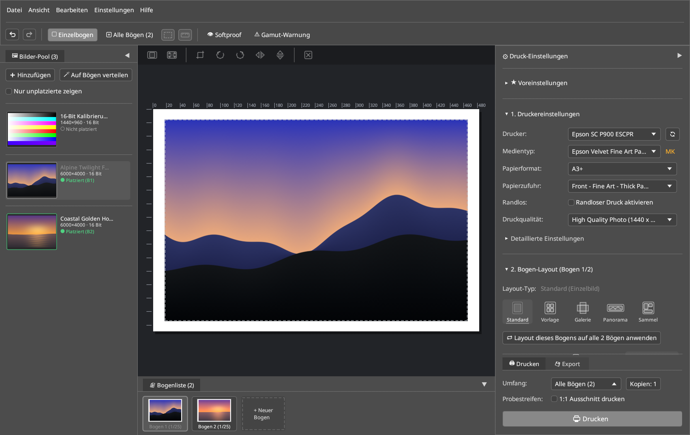

# LumaPrint — Benutzerhandbuch

**LumaPrint** ist ein natives 16-Bit Fine-Art-Drucklayout-, Live-Softproof- und Advanced-B&W-Studio für Linux (`Wayland` & `X11`).

Angelehnt an den Workflow von *Epson Print Layout* sowie *Qimage / Mirage*, schließt LumaPrint unter Linux die Lücke zwischen Bildbearbeitung (Darktable, RawTherapee, GIMP) und hochwertigen Fotodruckern – mit tiefer Hardware-Integration für den **Epson SureColor SC-P900** und **SC-P700** sowie universeller Unterstützung für jeden in CUPS eingerichteten Systemdrucker.

---

## Was kann LumaPrint?

- **Durchgängige 16-Bit-Farbpipeline:** Lädt 8-Bit- und 16-Bit-TIFF-, PNG-, JPEG- und WebP-Bilder (inkl. eingebetteter `sRGB`-, `Adobe RGB (1998)`-, `Display P3`- oder `ProPhoto RGB`-Profile) und berechnet Druckbögen in nativer Druckerauflösung (`360` / `720` / `1440` DPI) mit bikubischer Catmull-Rom-Interpolation und 16→8-Bit Floyd-Steinberg-Dithering.
- **Fünf spezialisierte Druck-Layout-Modi:**
  - **Standard (Einzelbild):** Exakte Ränder oder Zielbildgrößen in Millimeter/Zoll, optische/mathematische Zentrierung, Passepartout-Rahmenlinien und Schnittmarken.
  - **Vorlage (Mehrere Bilder):** Bis zu 25 Bild-Slots pro Bogen, mitgelieferte *EPL-Theme*-Layouts und ein 2-stufiges interaktives **Vorlagen-Studio** für eigene Kontaktbögen und Bento-Layouts.
  - **Galerie Wrap (Leinwand-Keilrahmen):** Konfigurierbare Keilrahmen-Tiefe + Rückseiten-Umschlag mit gespiegelten, weichgezeichneten/schattierten oder farbigen Umschlagkanten sowie Falt-/Schnittmarken.
  - **Panorama (Rollenpapier & Banner):** Freie Rollenbreiten und Bannerlängen bis 3,2 Meter.
  - **Sammelbogen (Auto-Nesting):** Packt mehrere Bilder unterschiedlicher Wunschgrößen vollautomatisch und platzsparend auf Druckbögen oder Rollenpapier.
- **Mehrseiten-Workflow & Leuchttisch-Übersicht:** Bis zu 25 Druckbögen pro Sitzung verwalten, Bilder per Drag & Drop zwischen **Bilder-Pool**, **Bogenliste** und **Alle-Bögen-Übersicht** (`Strg+2`) verschieben und Pool-Bilder mit einem Klick automatisch auf Bögen verteilen.
- **Farbmanagement & Live-Softproof:**
  - **ICC-Papierprofile:** Relativ farbmetrisch, Perzeptiv, Sättigung und Absolut farbmetrisch inkl. Tiefenkompensation (BPC) und automatischer Abschaltung der Treiber-Farbkorrektur (`NoColorAdjustment`).
  - **Drucker-Automatik (`Adobe RGB` / `sRGB`):** Übergibt Bilder im weiten `Adobe RGB (1998)`-Farbraum (`LUT 0x06`, analog zu *Epson Print Layout*) oder `sRGB` direkt an den Druckertreiber.
  - **Live-Softproof (`Strg+Umschalt+S`):** Echtzeit-Simulation von Papierweiß und Schwarzdichte (`D50 5000K`, `D55`, `D65`, `Kunstlicht`) sowie Gamut-Warnung (`Strg+Umschalt+G`), inklusive nativem Wayland/KWin Wide-Gamut Surface-Tagging (`wp_color_manager_v1`).
- **Advanced B&W Photo (`ABW`):** Interaktiver 2D-Farbtonkreis (`Neutral`, `Kühl`, `Warm`, `Sepia` oder freie Koordinaten), Mittelton-Dichte, Tiefen-/Lichter-Tonung, maximale optische Dichte und Spitzlichtniveau-Verschiebung.
- **Nahtlose Integration für eigene Papiere (`epmi`):** Erkennt automatisch alle über den [**EP Media Installer (`epmi`)**](https://github.com/colorcube/ep-media-installer) installierten Fine-Art-Papiere und zugehörigen ICC-Profile.

## Was ist es nicht?

- **Kein RAW-Konverter und keine Retusche-Software:** Entwickle deine RAW-Dateien wie gewohnt in Darktable, RawTherapee oder Lightroom und übergebe die fertigen 16-Bit-TIFFs (z. B. in `Adobe RGB` oder `ProPhoto RGB`) an LumaPrint für Layout, Softproof, Ausgabe-Nachschärfung und Druck.
- **Kein eigenständiger Druckertreiber:** LumaPrint übergibt fertig gerasterte Druckaufträge an CUPS. Für den Epson SureColor SC-P900 empfiehlt sich die Kombination mit [**epson-p900-escpr-cups**](https://github.com/colorcube/epson-p900-escpr-cups) für volle 10-Kanal-Hardwarekontrolle (`PK`/`MK`, Carbon Black, Black Enhance Overcoat, Walzenabstand und NVRAM-Slots).

---

## Kapitelübersicht

1. [**Schnellstart & Typischer Arbeitsablauf**](1-schnellstart-und-workflow.md) — Installation, der Weg zum ersten Fine-Art-Druck in 4 Schritten und CLI-Schnellstart.
2. [**Hauptfenster, Bilder-Pool & Docks**](2-hauptfenster-und-bedienung.md) — Aufbau der Oberfläche, direkte Bogen-Manipulation, Beschnitt, Bogen-Navigation und Dock-Anpassung.
3. [**Layout-Modi & Vorlagen-Studio**](3-layout-modi-und-vorlagen.md) — Standard, Vorlage (2-stufiges Vorlagen-Studio), Galerie Wrap, Panorama und Sammelbogen.
4. [**Drucker, Medien & Papierzufuhr**](4-drucker-medien-und-zufuhr.md) — CUPS-Druckererkennung, Medien-Logik (`PK`/`MK`), Papierzufuhren und eigene Papiere (`epmi`).
5. [**Farbmanagement, Softproof & Advanced B&W**](5-farbmanagement-softproof-und-abw.md) — ICC-Papierprofile, Rendering Intents, Live-Softproof, Wayland Wide-Gamut und Advanced B&W Photo (`ABW`).
6. [**Grundlagen: Farbräume & ICC-Profile erklärt**](6-farbraeume-und-profile-erklaert.md) — Hintergrundwissen zu `sRGB` vs. `Adobe RGB` vs. `ProPhoto RGB`, Drucker-LUTs vs. ICC-Profile und Basis-Medientypen.
7. [**Profi-Funktionen, 16-Bit-Export & IPP-Tintenstand**](7-pro-funktionen-und-ipp.md) — Sammelbogen Auto-Nesting, 1:1-Probestreifen, Ausgabe-Nachschärfung, 16-Bit-TIFF/PNG-Bogenexport und IPP-Tintenstandsanzeige.
