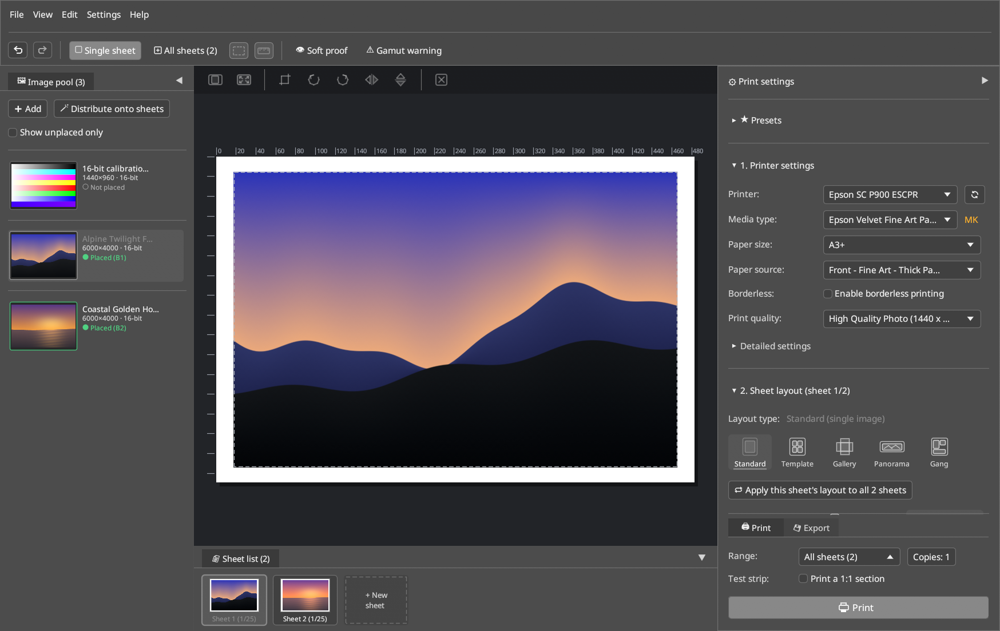

# 1. Quickstart & Typical Workflow

This chapter shows how to install **LumaPrint**, launch the desktop studio, and create your first color-managed Fine-Art print in four steps.

---

## 1. Installation & Launch

### Build & Install from Source

```bash
cargo build --release --workspace
sudo install -m 0755 target/release/lumaprint target/release/lumaprint-cli /usr/local/bin/
./bin/install-desktop
```

Running `./bin/install-desktop` installs the desktop entry (`de.colorcube.lumaprint.desktop`), AppStream metadata, and icons into `~/.local/share` so **LumaPrint** appears in your application launcher.

### Launching LumaPrint

Launch **LumaPrint** from your desktop application menu or from a terminal:

```bash
# Start with an empty session:
lumaprint

# Or pass one or more image files directly on the command line:
lumaprint ~/Photos/FineArt_01.tif ~/Photos/FineArt_02.tif
```

> [!TIP]
> You can configure LumaPrint as an external editor / print helper in **Darktable**, **RawTherapee**, **DigiKam**, or **Geeqie** by passing the exported 16-bit TIFF file path as a command-line argument to `lumaprint`.

---

## 2. Your First Fine-Art Print in 4 Steps



### Step 1: Import Images into the Image Pool (Left Dock)

1. Click **+ Add** in the **🖼 Image pool** dock on the left (or press `Ctrl+O`), or simply drag and drop `.tif`, `.png`, `.jpg`, or `.webp` files from your file manager into the window.
2. To place an image onto the current sheet, **double-click** its card in the Image Pool, **drag** it onto a slot on the sheet, or click **🪄 Distribute onto sheets** to automatically populate sheets with all unplaced images.

### Step 2: Select Printer, Media Type & Paper Size (Right Dock → `1. Printer settings`)

1. Choose your CUPS queue under **Printer** (e.g. `Epson_SC_P900`).
2. Select your paper under **Media type** (e.g. `Velvet Fine Art Paper` or a custom paper installed via [`epmi`](https://github.com/colorcube/ep-media-installer)).
   - LumaPrint automatically selects the matching black ink badge (**`PK`** Photo Black vs. **`MK`** Matte Black) and default **Paper source** (e.g. `Rear feed (sheet)` or `Front feed – Fine Art`).
3. Select the **Paper size** (e.g. `A4`, `A3`, `A3+`, `A2`) and **Print quality** (e.g. `High quality / Photo (1440 x 1440 dpi)` or `Max. quality (2880 x 1440 dpi)`).

### Step 3: Adjust Layout (`2. Sheet layout`)

1. Choose a **Layout type**:
   - **Standard:** Single image on the sheet. Drag the corner handles directly on the canvas to resize, or enter exact millimeter margins / print dimensions.
   - **Template:** Multi-image contact sheet or Bento layout (up to 25 slots).
   - **Gallery:** Canvas stretcher frame with mirrored or shaded wrap borders.
   - **Panorama:** Roll paper / banner print.
   - **Gang:** Automatic space-saving nesting of multiple print sizes.
2. Use the frameless icon strip directly above the sheet to switch between **Fit** (`Bild einpassen`) and **Fill** (`Fläche ausfüllen`), open the **Crop** modal (`✂`), or rotate/flip the image.

### Step 4: Configure Color Management, Softproof & Print (`3. Color settings` & Footer)

1. Under **3. Color settings**, select your **Color mode**:
   - **Color-managed (ICC paper profile):** LumaPrint applies the paper's `.icc` profile (with Relative Colorimetric intent + Black Point Compensation by default) and disables the printer driver's internal color correction (`NoColorAdjustment`).
   - **Printer automatic:** Sends the image in `Adobe RGB (1998)` (`LUT 0x06`, matching *Epson Print Layout*) to the printer driver.
   - **Black & white (Advanced B&W):** Enables neutral or toned monochrome printing (**Advanced** view).
2. Optional: Click **👁 Soft proof** (`Ctrl+Shift+S`) in the top toolbar and enable **Paper white** to preview how the paper's white point and black density will look under `D50 (5000K)` viewing light.
3. In the sticky bottom footer of the Right Dock, choose the **Range** (`All sheets` or `Current sheet`), optionally enable **Test strip (Print a 1:1 section)** to print a narrow test band first, and click **🖨 Print** (or switch to the **💾 Export** tab to save a 16-bit TIFF/PNG sheet).

---

## 3. Headless CLI Quickstart (`lumaprint-cli`)

For batch workflows, studio automation, or printing calibration charts without opening the GUI, use `lumaprint-cli`:

```bash
# List discovered CUPS printers and ICC profiles:
lumaprint-cli printers
lumaprint-cli icc-list

# Render a 16-bit print sheet to a 720 DPI TIFF file:
lumaprint-cli render \
  --image ~/Photos/AlpineTwilight.tif \
  --paper A3+ \
  --media VelvetFineArt \
  --dpi 720 \
  --output /tmp/sheet_a3plus.tif
```
