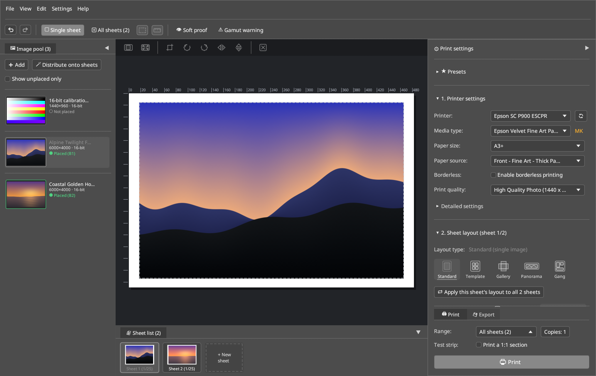

# 2. Main Window, Image Pool & Docks

The main window of **LumaPrint** is modeled directly after the clear workflow of **Epson Print Layout** (cf. EPL User Guide pp. 15–17, 45).

## Main Window Layout

1. **Main Menu & Toolbar (Top):**
   - **Add images or folders:** Loads 8/16-bit TIFF, PNG, or JPEG files into the image pool.
   - **Crop image (`✂ Crop image…`):** Opens the crop view for the currently selected image (alternatively via **double-click** directly on the image in the sheet canvas).
   - **Soft proof & Gamut warning (`👁 Soft proof` / `⚠ Gamut warning`):** Toggles live paper simulation (including `Paper white` and viewing light temperature `D50` / `D65` / `3200K`) as well as the warning overlay for non-printable colors.
   - **Test strip (`Print a 1:1 section`):** Selects a narrow strip of the image to test-print at the exact 1:1 original scale of a large print on a smaller sheet to save paper.
   - **Show/hide docks (`F8` / `F9` / `F10`):** Collapses or expands the image pool, sheet list, or the right-hand print settings dock for maximum preview space.
2. **Image Pool (Dockable on the Left, Bottom, or Right):**
   - Shows loaded images with thumbnail, file name, pixel resolution (`px`), bit depth (`8/16-bit`), and embedded source ICC profile (`sRGB`, `Adobe RGB`, `ProPhoto RGB`).
   - Images can be placed onto the sheet (or into template slots) by clicking or via drag & drop.
   - Via *View → Arrange docks* (or *Settings → Arrange docks*), the `Image pool position` and `Sheet list position` can be freely docked on the **Left edge**, **Right (tab next to print settings)**, **Below the sheet only**, or **Full width at the bottom**.
3. **Editing Canvas (Central Sheet View):**
   - Displays the exact paper size with rulers (`mm` or `inch`), non-printable margins, frame lines, or Gallery Wrap fold lines.
   - **Direct dragging of the 4 image corners:** Scales the image or adjusts margins live on the sheet.
   - **Workspace background color:** Configurable between *Dark gray (default)*, *Medium gray*, *Light gray*, and *White*.
4. **Print Settings Panel (Right Dock, Collapsible Sections):**
   - **★ Presets:** Quickly load, save, export, and import complete configurations (`.json`).
   - **1. Printer settings:** Printer, Media type, Paper size, Paper source, Print quality, and *Detailed settings*.
   - **2. Sheet layout:** *Standard (single image)*, *Panorama (roll paper / banner)*, *Gallery Wrap (canvas stretcher frame)*, *Template (multiple images)*, and *Gang sheet (auto nesting)*.
   - **3. Color settings:** *Color-managed (ICC paper profile)*, *Printer automatic*, *Black & white (Advanced B&W)*, and *Calibration (no color management)*.
   - **4. Printer status & ink levels (IPP):** Live ink levels via IPP (`🔄 Refresh IPP`).
5. **Status & Print Bar:**
   - **Message area:** Displays real-time warnings (e.g., when the selected paper size in *Gallery Wrap* is smaller than the required size, or when the effective image resolution drops below `240 ppi`).
   - **Paper size & Effective resolution (`ppi`):** Shows the resulting print resolution of the scaled image on the paper in real time.
   - **Sheet navigation (`< 1 / N >`), Range, Copies & `🖨 Print` button.**

## Removing Images with `Del`

- If an image slot is selected on the sheet, pressing `Del` removes the image from that slot while keeping it in the image pool.
- If an image in the image pool was clicked last, pressing `Del` removes it from the pool (and from all sheets).
- Both actions can be undone with `Ctrl+Z`. While a text input field has focus, `Del` does not affect images.

## Persistent Settings

LumaPrint automatically saves all settings on exit — and continuously about once per second after any change — to `~/.config/lumaprint/settings.json` (or `$XDG_CONFIG_HOME/lumaprint/settings.json`):

- Printer, Media type, Paper size, Paper source, Print quality, and *Detailed settings* (Overcoat, etc.)
- Color settings (Color mode, ICC profile, Rendering intent, BPC, ABW controls, Output sharpening) and export settings
- View preferences (Unit of measurement, rulers, dock positions, background color) as well as UI theme and font scaling
- Presets, custom media, custom paper and canvas sizes, templates, ABW toning presets, and custom frame colors

Images, sheets, and sheet layouts belong to the current print job and are not persisted across restarts. If the previously saved printer is no longer available, the system default printer is used. If a corrupted settings file is encountered at startup, it is backed up as `settings.json.bak` and LumaPrint starts with default values.
