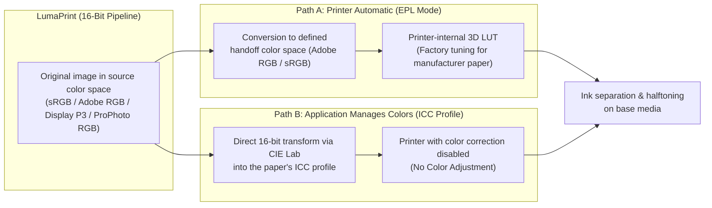

# 6. Fundamentals: Color Spaces & ICC Profiles Explained

In fine-art and photo printing, two fundamentally different color worlds meet: your digital photograph uses **additive light colors** (Red, Green, Blue on a self-luminous monitor), whereas the printer deposits **subtractive pigment inks** (ten distinct ink channels on the Epson SureColor SC-P900) onto paper that reflects ambient light.

This chapter explains step by step how color spaces and ICC profiles bridge this gap, what role printer driver settings play, and when to choose which color mode.

> [!NOTE]
> **Applicability to Other Printers:**
> Throughout this chapter, we illustrate the workflow using the **Epson SureColor photo printers (SC-P900 / SC-P700)** as a concrete example, because all color modes are clearly exposed there. However, the underlying principles — the distinction between printer-internal color management (`sRGB` / `Adobe RGB`) and application-managed ICC color management — apply **identically or nearly identically to photo printers from other manufacturers** (such as Canon imagePROGRAF / PIXMA PRO, HP DesignJet) as well as modern driverless network printers (*IPP Everywhere / AirPrint*).

---

## 1. The Core Principle: Why Not All RGB Is Created Equal

An image file stores three color values for every pixel: **Red, Green, and Blue (RGB)** — as numbers from `0` to `255` in 8-bit images, or from `0` to `65535` in 16-bit images.

Without additional metadata, however, these numbers are ambiguous: a value like `RGB(0, 255, 0)` merely means *"the most saturated green possible in this system"*, without specifying **which actual physical shade of green** is meant. Only an associated **source color space** (embedded in the image file as an ICC profile) links the RGB numbers to an absolute, device-independent reference system (**CIE Lab / CIE XYZ**) modeled on human vision.

### Primary Source Color Spaces in Photography

| Color Space | Characteristics & Use Case | Significance for Photo Printing |
| :--- | :--- | :--- |
| **sRGB** | Lowest common denominator for web browsers, smartphones, and standard office monitors. | Clips highly saturated turquoise, emerald green, yellow, and deep blue tones that modern cameras capture and high-end photo printers can easily reproduce. |
| **Adobe RGB (1998)** | Significantly wider gamut, especially in green, cyan, and blue tones. | Excellent all-round working space for photo printing; covers the vast majority of printable colors. |
| **Display P3** | Modern wide-gamut standard used by current displays and mobile devices (roughly 25% larger than sRGB, strong in reds/oranges/greens). | Good coverage of warm and vibrant tones, though slightly narrower than Adobe RGB in the cyan region. |
| **ProPhoto RGB (ROMM)** | Extremely wide working color space (default in RAW developers like Lightroom or Darktable) encompassing virtually all photographically capturable colors. | Should always be passed as a **16-bit file** (e.g., 16-bit TIFF) to prevent posterization/banding. Allows the printer to utilize even the most delicate extreme colors at the very edge of its physical capability. |

### How LumaPrint Handles Source Color Spaces

Many basic printing utilities convert imported images into `sRGB` as soon as they are opened — permanently discarding all wide-gamut colors from `Adobe RGB` or `ProPhoto RGB`.

**LumaPrint works differently:** Every imported image retains its **original 16-bit source color space** (`sRGB`, `Adobe RGB`, `Display P3`, or `ProPhoto RGB`) in memory. Only at the very end of the pipeline — immediately for the monitor preview or for the print job — are colors transformed in full 16-bit precision into the target color space.

---

## 2. What the Printer Actually Receives

Even though a photo printer like the Epson SC-P900 prints with **ten individual ink channels** (*Photo Black, Matte Black, Gray, Light Gray, Cyan, Light Cyan, Vivid Magenta, Vivid Light Magenta, Yellow, Violet*), it does not expect per-nozzle ink droplet commands from the computer during standard print jobs.

Instead, the printer still receives **24-bit RGB pixel data** (at 720 DPI). Splitting those RGB values across the ten ink channels (e.g., deciding when to add gray, when to transition from Light Cyan to Cyan, or when to blend in Violet ink) and halftoning/dithering are performed by the **hardware/firmware inside the printer itself** (or by the proprietary driver core on other printer brands).

Therefore, the central question when printing is:

> **Who performs the colorimetric translation from the photograph to the paper — the printer itself (Path A) or the application using an ICC paper profile (Path B)?**

---

## 3. Path A: The Printer Manages Colors ("Printer Automatic" / EPL Mode)

### Why Does This Mode Exist?

Not every application on a computer supports ICC color management, knows about paper profiles, or offers controls for *rendering intents* and *black point compensation*. So that users can still get high-quality prints from any application (or without managing ICC profiles manually), photo printers include **built-in lookup tables (hardware LUTs)** tailored to the manufacturer's own papers.

In effect, the printer says in this mode: *"Simply send me the image data in a known standard color space (`sRGB` or `Adobe RGB`) and tell me which genuine paper is loaded — I will handle the rest of the color tuning myself."*

### The Role of `sRGB` vs. `Adobe RGB` in This Mode

Because no individual paper profile is applied on the computer in this mode, the application and the printer must agree on which color space the transmitted RGB numbers represent:

1. **Handoff as `sRGB` (*sRGB (EPSON standard)*):**
   LumaPrint converts the image to `sRGB` before sending it and instructs the printer to use its internal `sRGB` table (`LUT 0x00`). Vivid colors outside the small `sRGB` gamut are clipped before reaching the printer.
2. **Handoff as `Adobe RGB` (*Adobe RGB (EPL automatic / recommended)*):**
   LumaPrint hands over the image data in the much wider **`Adobe RGB (1998)`** color space and instructs the printer to use its internal `Adobe RGB` hardware table (`LUT 0x06`). Saturated blues, turquoises, and greens are preserved and mapped by the printer into the full ink gamut.

### Characteristics and Limitations of This Mode

- **Pleasing Factory Tuning ("Photo Look"):** The printer's internal table does not operate strictly colorimetrically; instead, it applies a proprietary manufacturer curve (slightly livelier skin tones, punchier contrast, vibrant sky blues).
- **Manufacturer Papers Only:** The printer firmware only knows the factory-installed manufacturer media types. The specific surface tint and ink absorption behavior of third-party fine-art papers (e.g., Hahnemühle, Photolux, Canson, Ilford) are unknown to the printer's internal color tables.
- **No Exact Soft Proof Possible:** Because the proprietary transformation takes place inside the closed printer firmware, the result cannot be simulated 1:1 in advance on the monitor via soft proofing.

---

## 4. Path B: The Application Manages Colors (ICC Paper Profiles & Third-Party Media)

For color-accurate work, **on-screen soft proofing**, and **all third-party fine-art papers**, **application-managed ICC color management** is the gold standard.

### How Does an ICC Paper Profile Work Technically?

A common misconception is that an ICC profile for a third-party paper (such as *Hahnemühle Photo Rag* or *Photolux Studio*) drives the printer completely from scratch. In reality, the system operates in **three stages**:

1. **Stage 1 — The Base Media Type as the Physical Foundation in the Printer:**
   Every ICC profile builds on a specific **standard base media type** of the printer (usually *Velvet Fine Art Paper* for textured cotton papers, or *Premium Semigloss* / *Premium Luster* for baryta and luster papers). The paper manufacturer specifies which base media type to select in the profile's data sheet.
   This base media setting governs all physical fundamentals inside the printer:
   - Platen gap and paper feed speed,
   - the choice between *Photo Black (PK)* and *Matte Black (MK)*,
   - the maximum base ink limit (so the paper does not cockle or bleed),
   - and the base linearization of the ten ink channels.
2. **Stage 2 — Profiling with Printer Color Correction Disabled (`No Color Adjustment`):**
   To create an ICC profile for a new paper, the matching base media type is selected in the driver and all printer-internal color correction is turned off (**`No Color Adjustment`**). In this raw state, a test chart containing hundreds of known `(R, G, B)` control patches is printed.
   Naturally, this uncalibrated print initially exhibits color casts or tonal shifts. Next, a spectrophotometer measures every printed patch in the absolute **`CIE Lab` color space**.
3. **Stage 3 — The ICC Profile as a Precision Correction Table:**
   Comparing the transmitted `(R, G, B)` control values against the actual `Lab` colors measured on the paper yields the `.icc` profile. It contains lookup tables for two directions:
   - **For Printing (`Lab → Printer RGB`):** The profile knows the exact pre-compensated `(R', G', B')` values that must be sent to the printer in `No Color Adjustment` mode so that the final ink on paper produces the exact `Lab` color intended by your photograph.
   - **For On-Screen Soft Proofing (`Printer RGB / Lab → Monitor`):** Because the measurement also captured the actual paper white, the deepest achievable black ($D_{\max}$), and the outer gamut boundary, the ICC profile knows the true color gamut of this paper-and-ink combination and can simulate it reliably on your monitor beforehand.

### No Detour Through sRGB or Adobe RGB!

A decisive advantage of the ICC mode in LumaPrint:
When you print with an ICC paper profile, your image is **never converted through an intermediate sRGB or Adobe RGB bottleneck**.

If your photograph is stored in the wide **`ProPhoto RGB`** or **`Adobe RGB`** color space, LumaPrint's 16-bit color management engine transforms every pixel **directly from the image's source color space via `CIE Lab` into the control values of the paper's ICC profile**. Every subtle color nuance in your photo that the inks can physically reproduce on that paper reaches the print without artificial clipping.

> [!IMPORTANT]
> **Golden Rule When Printing with ICC Profiles: No Double Color Management!**
> If you viewed the raw print data calculated by an ICC profile directly on a monitor, it would often look off-color or shifted in contrast — because it already bakes in the inverse correction for the specific paper.
> For colors to come out accurately on paper, the printer's own color correction must be disabled (**`No Color Adjustment`**) and the exact same base media type used during profiling must be selected. In **LumaPrint**, disabling driver color correction happens automatically whenever *Color-managed (ICC paper profile)* is active.

---

## 5. What Does `EP Media Installer (epmi)` Store in the Printer?

With tools such as [`ep-media-installer` (`epmi`)](https://github.com/colorcube/ep-media-installer), configuration packages (`.emy` / `.emx`) for third-party papers can be downloaded and registered in the printer. Here too, responsibilities are cleanly separated:

1. **What Is Stored Inside the Printer:**
   In its custom media slots (`Slot 1..30`), the printer stores **only the mechanical and physical paper parameters**: paper name for the printer display, platen gap, paper thickness in millimeters, feed adjustment, drying time, ink duty, and the mapping to the internal base media type. **The printer itself does not store or process `.icc` color profiles.**
2. **What Is Stored on the Computer:**
   The accompanying `.icc` profile is installed as a file on the computer's disk. **LumaPrint** loads this `.icc` profile for the 16-bit color transformation and on-screen soft proof while simultaneously passing the matching mechanical custom-media parameters to the printer driver.

---

## 6. Practical Decision Guide: Which Mode for Which Task?

| Setting in LumaPrint | When to Use | What Happens Behind the Scenes |
| :--- | :--- | :--- |
| **Color-managed (ICC paper profile)** *(Recommended default for fine-art & soft proofing)* | • **Mandatory** for all third-party papers (Hahnemühle, Photolux, Canson, Ilford, etc.) • For manufacturer papers when maximum color accuracy and a 1:1 match with the on-screen **soft proof** are desired | LumaPrint transforms directly from the image's source color space (`ProPhoto RGB` / `Adobe RGB` / `sRGB`) into the paper's `.icc` profile and automatically disables printer-internal color correction (`No Color Adjustment`). |
| **Printer automatic** *(Epson Print Layout mode — `Adobe RGB`)* | • Quick everyday and portrait photo printing on **genuine manufacturer papers** (e.g., *Epson Glossy, Premium Glossy, Luster, Baryta*) when the printer's punchy factory look is desired | LumaPrint hands over the image losslessly in the wide `Adobe RGB` color space; the printer firmware performs the color tuning (*Epson Adobe RGB* / *Epson Standard*). |
| **Black & white (Advanced B&W)** | • For neutral or finely toned black-and-white fine-art prints | Uses the printer firmware's `AdvancedBW` mode (on `epson-p900-escpr-cups`) or LumaPrint's 16-bit B&W toning curves for color-cast-free grayscale prints. |
| **Calibration (no color management)** *(No Color Adjustment)* | • **For profiling measurements only:** When printing uncalibrated test charts to measure with a spectrophotometer and build a custom ICC profile | Image data is sent completely unaltered (`Raw RGB`) with printer color correction disabled. |

---

*For detailed instructions on operating the color controls in LumaPrint, see **[Color Management, Soft Proof & Advanced B&W Photo (ABW)](5-color-management-and-abw.md)**.*
