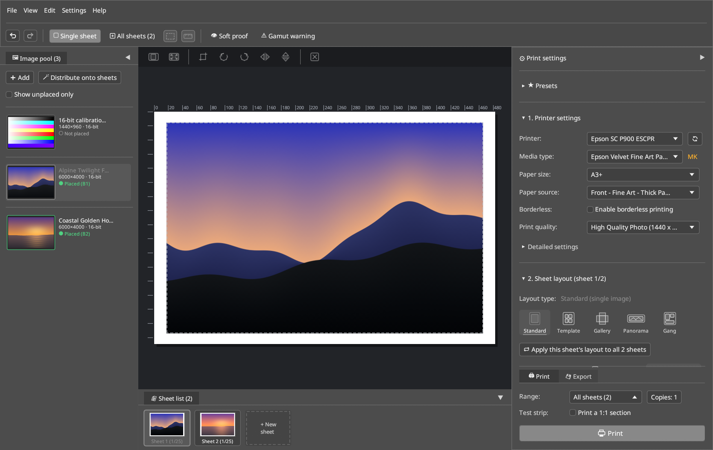

# LumaPrint — User Manual

**LumaPrint** is a native 16-bit Fine-Art print layout, live softproofing, and Advanced B&W studio for Linux (`Wayland` & `X11`).

Modeled after the workflow of *Epson Print Layout* and *Qimage / Mirage*, LumaPrint bridges the gap between raw/image editors (Darktable, RawTherapee, GIMP) and high-end photo printers — with deep hardware integration for the **Epson SureColor SC-P900** and **SC-P700** alongside universal support for any installed CUPS printer.

---

## What Can LumaPrint Do?

- **End-to-End 16-Bit Color Pipeline:** Loads 8-bit and 16-bit TIFF, PNG, JPEG, and WebP images (preserving embedded `sRGB`, `Adobe RGB (1998)`, `Display P3`, or `ProPhoto RGB` profiles) and renders print sheets at native printer resolution (`360` / `720` / `1440` DPI) using Catmull-Rom bicubic interpolation and Floyd-Steinberg 16→8-bit dithering.
- **Five Specialized Print Layout Modes:**
  - **Standard (Single Image):** Exact millimeter/inch margins or target print dimensions, optical/mathematical centering, passepartout frame lines, and corner cut marks.
  - **Template (Multiple Images):** Up to 25 slots per sheet, built-in *EPL Theme* layouts, and a 2-stage interactive **Template Studio** for custom Bento/contact sheets.
  - **Gallery Wrap (Canvas Stretcher Frame):** Configurable stretcher bar depth + back-fold extension with mirrored, blurred/shaded, or solid-color wrap borders and corner fold marks.
  - **Panorama (Roll Paper & Banners):** Custom roll widths and banner lengths up to 3.2 meters.
  - **Gang Sheet (Auto-Nesting):** Automatically packs multiple images of different physical sizes onto sheets or roll paper to minimize paper waste.
- **Multi-Sheet Workflow & Light-Table View:** Manage up to 25 print sheets in a single session, drag images between the **Image Pool**, **Sheet List**, and **All Sheets Overview** (`Ctrl+2`), and auto-distribute pool images across sheets with one click.
- **Color Management & Live Softproofing:**
  - **ICC Paper Profiles:** Relative Colorimetric, Perceptual, Saturation, and Absolute Colorimetric intents with Black Point Compensation (BPC) and automatic driver color-correction lock (`NoColorAdjustment`).
  - **Printer Automatic (`Adobe RGB` / `sRGB`):** Sends wide-gamut `Adobe RGB (1998)` (`LUT 0x06`, matching *Epson Print Layout*) or `sRGB` directly to the printer driver.
  - **Live Softproof (`Ctrl+Shift+S`):** Real-time paper white & matte black simulation (`D50 5000K`, `D55`, `D65`, `Tungsten`) and out-of-gamut warning (`Ctrl+Shift+G`), with native Wayland/KWin wide-gamut surface tagging (`wp_color_manager_v1`).
- **Advanced B&W Photo (`ABW`):** Interactive 2D color toning wheel (`Neutral`, `Cool`, `Warm`, `Sepia`, or custom coordinates), midtone density, shadow/highlight tonality, maximum optical density, and highlight point shift.
- **Seamless Custom Media (`epmi`) Integration:** Automatically discovers custom Fine-Art papers and ICC profiles installed by [**EP Media Installer (`epmi`)**](https://github.com/colorcube/ep-media-installer).

## What Is It Not?

- **Not a RAW developer or retouching suite:** Develop your RAW files in Darktable, RawTherapee, or Lightroom first, then export 16-bit TIFFs (e.g. in `Adobe RGB` or `ProPhoto RGB`) into LumaPrint for layout, softproofing, output sharpening, and printing.
- **Not a printer driver by itself:** LumaPrint spools rasterized print jobs through CUPS. For the Epson SureColor SC-P900, pair it with [**epson-p900-escpr-cups**](https://github.com/colorcube/epson-p900-escpr-cups) for full 10-channel hardware control (`PK`/`MK`, Carbon Black, Black Enhance Overcoat, platen gap, and custom NVRAM slots).

---

## Manual Chapters

1. [**Quickstart & Typical Workflow**](1-quickstart-and-workflow.md) — Installing LumaPrint, your first Fine-Art print in 4 steps, and CLI usage.
2. [**Main Window, Image Pool & Docks**](2-main-window-and-docks.md) — Workspace areas, direct canvas manipulation, cropping, multi-sheet navigation, and dock customization.
3. [**Layout Modes & Template Studio**](3-layout-modes-and-templates.md) — Standard, Template (2-stage Template Studio), Gallery Wrap, Panorama, and Gang Sheet modes.
4. [**Printer, Media & Paper Feed**](4-printer-media-and-cups.md) — CUPS printer discovery, media constraints (`PK`/`MK`), paper feed paths, and custom media (`epmi`).
5. [**Color Management, Soft Proof & Advanced B&W**](5-color-management-and-abw.md) — ICC paper profiles, rendering intents, live softproofing, Wayland wide-gamut, and Advanced B&W Photo (`ABW`).
6. [**Fundamentals: Color Spaces & ICC Profiles Explained**](6-color-spaces-explained.md) — Background guide on `sRGB` vs. `Adobe RGB` vs. `ProPhoto RGB`, printer LUTs vs. ICC profiles, and base media types.
7. [**Pro Features, 16-Bit Export & IPP Ink Levels**](7-pro-features-and-ipp.md) — Gang sheet auto-nesting, 1:1 test strips, output sharpening, 16-bit TIFF/PNG sheet export, and IPP ink monitoring.
